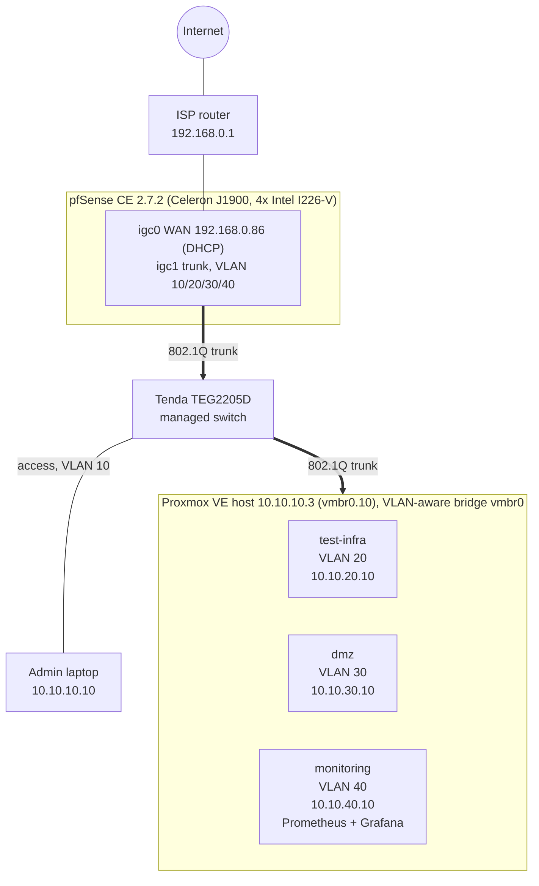

# Enterprise Network Segmentation & Firewall Lab

I built a small-office network built on real hardware: a pfSense firewall, a VLAN-capable managed switch and a Proxmox hypervisor. The lab implements zone-based segmentation with least-privilege firewall policy, centralized monitoring and documented verification of every rule.

## Goals

- Segment a flat network into four security zones using 802.1Q VLANs.
- Enforce inter-zone policy on a stateful firewall (default deny, narrow exceptions).
- Monitor every node (hypervisor, VMs, firewall) with Prometheus and Grafana.
- Prove the policy works with documented tests, and record the problems found along the way.

## Topology

## Security zones

| Zone | VLAN | Subnet | Gateway | Purpose |
|---|---|---|---|---|
| MGMT | 10 | 10.10.10.0/24 | 10.10.10.1 | Administration: hypervisor, switch, admin workstation |
| INFRA | 20 | 10.10.20.0/24 | 10.10.20.1 | Internal servers |
| DMZ | 30 | 10.10.30.0/24 | 10.10.30.1 | Internet-facing services |
| MONITORING | 40 | 10.10.40.0/24 | 10.10.40.1 | Metrics collection and dashboards |

## Security model

1. **Default deny.** Nothing is allowed unless a rule says so.
2. **Zones cannot reach private networks.** INFRA, DMZ and MONITORING each have a *Block any to RFC1918* rule above their internet-access rule. This stops lateral movement and also keeps VMs away from the ISP router and the hypervisor.
3. **Narrow exceptions above the block.** Only DNS and ICMP to the zone's own gateway, plus (for MONITORING) TCP/9100 from one host to the exporter list.
4. **Management is separate.** The hypervisor lives in its own VLAN. The management network is the only one that can reach it.
5. **Secrets stay out of this repo** (see `.gitignore`).

### Access matrix (as built)

| From \ To | MGMT | INFRA | DMZ | MONITORING | Internet |
|---|---|---|---|---|---|
| MGMT | n/a | SSH only, from the admin PC | SSH only, from the admin PC | SSH, Grafana, Prometheus (admin PC) | web (80/443), NTP |
| INFRA | blocked | n/a | blocked | blocked | allowed |
| DMZ | blocked | blocked | n/a | blocked | web (80/443), NTP |
| MONITORING | blocked | 9100 only | 9100 only | n/a | web (80/443), NTP |

Admin access is limited to one workstation (10.10.10.10). Proxmox is reachable on 22 and 8006 only.

All zones may also use the DNS resolver and answer ICMP on their own gateway address.

## Documentation

| Document | Content |
|---|---|
| [01 Topology](docs/01-topology.md) | Hardware, cabling, switch port map |
| [02 VLANs and addressing](docs/02-vlans-addressing.md) | VLAN IDs, subnets, DHCP, Proxmox bridge |
| [03 Firewall rules](docs/03-firewall-rules.md) | Aliases and rules per interface |
| [04 Verification](docs/04-verification.md) | Test matrix: command, expectation, result |
| [05 Monitoring](docs/05-monitoring.md) | Prometheus, Grafana, node_exporter |
| [06 Troubleshooting](docs/06-troubleshooting.md) | Real problems, root causes and fixes |
| [configs/](configs/) | Sanitized configuration files |

## Tech stack

pfSense CE 2.7.2, Proxmox VE, Debian 13, Docker, Prometheus, Grafana, node_exporter, 802.1Q VLANs.

## Roadmap

- [x] Replace MGMT *pass any* with explicit rules
- [ ] Active Directory (Windows Server, domain `corp.lab`) in INFRA
- [ ] Ansible control VM (`ansible-01`, MGMT): update, audit and backup playbooks with reports
- [ ] Backup storage on a separate HDD (pending USB-SATA adapter)
- [ ] Admin WireGuard remote access into MGMT
- [ ] Suricata IDS on the DMZ
- [ ] DMZ service published through a Cloudflare Tunnel
- [ ] Hybrid cloud connectivity (site-to-site VPN, then BGP) as a separate project
